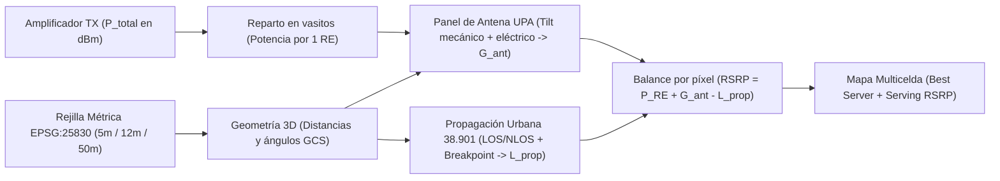
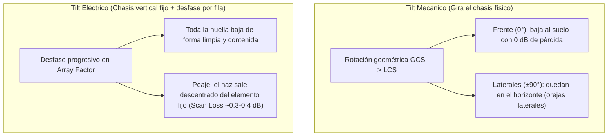

# Guía Didáctica `Spec 001`: Cómo viaja la señal 5G desde el panel hasta la calle (y cómo modelarlo en software limpio)

> **Propósito de esta guía (`mentor-guide`)**: Entender **cualitativamente y con intuición física** todo lo que hemos construido en `Spec 001` (`domain`, `antenna`, `radio`), sin memorizar fórmulas. Veremos cada pieza con **doble lente**: primero la intuición cotidiana, luego qué modela el estándar **3GPP** y finalmente por qué nuestro código Python está diseñado así.

---

## Mapa visual del viaje de la señal en `Spec 001`

Antes de entrar pieza por pieza, mira el recorrido completo que hace la energía desde que sale del amplificador de una celda hasta que el móvil decide a qué antena conectarse en cada punto del mapa:

---

## 1. Potencia en `dBm`, ganancias en `dB` y por qué prohibimos `Dbm + Dbm`

### 💡 La idea intuitiva (sin fórmulas)
Imagina que en vez de escribir el dinero normal de una cuenta bancaria (`1.000 €`), decides abreviarlo contando solo **cuántos ceros tiene**:
- Una cuenta de `1.000 €` la anotas como **"nivel 3"**.
- Si un banco te **multiplica tu dinero por 10**, basta con **sumar +1** a tu nivel (`nivel 3 + 1 = nivel 4`, `10.000 €`). ¡Multiplicar cantidades reales se convierte en una simple suma!
- Pero, ¿qué pasa si tienes **dos cuentas separadas** de `1.000 €` (`nivel 3` y `nivel 3`) y quieres saber cuánto dinero suman juntas? En el mundo real tienes `2.000 €` (`nivel 3,3`), **¡NO `nivel 3 + nivel 3 = nivel 6` (`1.000.000 €`)!**

En radiofrecuencia ocurre exactamente eso porque la potencia varía millones de veces entre el pie de la torre y un sótano:
- **`mW` (`LinearMw`)**: Es el "dinero real" (energía física en milivatios). Si dos antenas iluminan el mismo punto como interferencia, sus energías reales se suman aquí.
- **`dBm` (`Dbm`)**: Es el "contador de ceros" respecto a `1 mW` (`0 dBm = 1 mW`, `10 dBm = 10 mW`, `20 dBm = 100 mW`, `46 dBm ≈ 40.000 mW`). Cada `+10 dBm` es multiplicar por `10`; cada `+3 dBm` es aproximadamente multiplicar por `2`.
- **`dB` (`Db`)**: No es energía, sino un **factor de cambio** (ganancia o pérdida). Decir `+3 dB` significa *"el doble"*; decir `-3 dB` significa *"la mitad"*; decir `-30 dB` significa *"mil veces menos"*. Por eso **sí tiene todo el sentido sumar `dBm + dB`** (aplicar un multiplicador a una potencia), pero **sumar `dBm + dBm` es un disparate físico**.

### 📡 Lente de Dominio 5G (y los ángulos del mundo vs. la antena)
Además de potencias, en planificación celular conviven dos formas de medir ángulos que suelen chocar si se mezclan:
1. **Azimut brújula (`AzimuthDeg`)**: Mirando el mapa de Jaén desde arriba, `0°` es el **Norte**, `90°` el **Este**, `180°` el **Sur** y `270°` el **Oeste** (sentido horario).
2. **Ángulo cenital 3GPP (`ZenithDeg`)**: En lugar de usar `0°` para el horizonte, el estándar **3GPP TR 38.901** mide desde arriba hacia abajo:
   - `0°` = mirando verticalmente al cielo (*cenit*).
   - `90°` = mirando completamente recto al **horizonte**.
   - `180°` = mirando verticalmente al suelo bajo tus pies (*nadir*).
   Por tanto, como una antena en una azotea siempre está más alta que el móvil en la calle, el móvil siempre queda a un ángulo cenital **un poco mayor de `90°`** (por ejemplo `95°`, es decir, `5°` por debajo del horizonte).

### 🛠️ Lente de Ingeniería de Software (`domain/units.py` y `domain/grid.py`)
En la mayoría de scripts académicos todo son `float` sueltos, y tarde o temprano alguien suma dos `dBm` o mete radianes donde iban grados. En `RAN-city` aplicamos dos patrones clave:
- **Escudo de Tipos (*Value Objects* inmutables)** en `backend/ran_city/domain/units.py`: `Dbm.__add__` acepta `Db`, pero si intentas hacer `Dbm(40) + Dbm(40)` lanza inmediatamente un `TypeError` obligándote a pasar explícitamente por `.to_mw()`. Convertimos un error silencioso de física en un fallo inmediato y explícito.
- **Mallado métrico vectorizado (`ScenarioGrid`)** en `backend/ran_city/domain/grid.py`: Trabajamos siempre en metros reales (`EPSG:25830`) con resolución adaptada al entorno (`5 m` urbano denso, `12 m` urbano, `50 m` rural). El método `geometry_from_tx()` calcula las matrices completas de distancias (`d2d_m`, `d3d_m`) y ángulos (`zenith_gcs_deg`, `azimuth_gcs_deg`) de miles de píxeles en una sola pasada de `NumPy`, sin un solo bucle `for` en Python.

---

## 2. Antenas 5G: Elemento, Panel `UPA` y el duelo *Tilt Mecánico* vs. *Tilt Eléctrico*

### 💡 La idea intuitiva (sin fórmulas)

#### A) Un elemento vs. un panel entero (`Array Factor`)
- **Un elemento individual** es como una **linterna ancha montada sobre una chapa metálica**: alumbra bien hacia delante (en un abanico suave de `65°` donde la luz cae a la mitad, `-3 dB`) y casi nada hacia atrás porque la chapa lo tapa (`-30 dB`). Al no desperdiciar luz hacia atrás, ilumina al frente unas `6` veces más que una bombilla desnuda (`8 dBi`).
- **Un panel `8×8` (`Uniform Planar Array`, `64` elementos)** es como colocar **`64` altavoces idénticos en cuadrícula** sonando exactamente al compás:
  - Justo enfrente del panel, las `64` crestas de onda llegan sincronizadas y se refuerzan: el haz se vuelve mucho más estrecho y potente (concentra la energía `64` veces más: `+18 dB` extra sobre los `8 dBi` del elemento, rozando **`26 dBi`**).
  - Si te mueves arriba o a los lados, la onda de la fila 1 recorre un poquito más de camino que la de la fila 8; cuando una cresta coincide con el valle de otra, se anulan (aparecen nulos y pequeños lóbulos secundarios).

#### B) Tilt Mecánico vs. Tilt Eléctrico (¡aquí está la clave de la Pregunta 1!)
Queremos inclinar el haz principal hacia abajo (*downtilt*, por ejemplo `12°`) para iluminar nuestra calle cercana y no interferir al barrio de enfrente. Hay dos maneras de hacerlo, y **no deforman la huella igual**:

1. **Tilt Mecánico (subir a la torre y girar el soporte con una llave inglesa)**:
   - Imagina sujetar un **abanico abierto en horizontal** delante de tu pecho: el centro del abanico apunta de frente (`0°`) y las dos varillas de los extremos apuntan exactamente a tu izquierda y derecha (`-90°` y `+90°`).
   - Ahora inclina tus muñecas hacia abajo `12°`: el **centro del abanico baja hacia el suelo**, ¡pero **las dos varillas laterales (`±90°`) solo giran como un eje sobre sí mismas y siguen apuntando completamente rectas al horizonte**! (De hecho, hacia atrás la espalda del panel apunta hacia arriba).
   - **Consecuencia en la calle**: Al frente acortas el alcance como querías, pero por los laterales a `±90°` el haz **no baja**, dejando dos "orejas" (*ear lobes* / efecto pajarita) que siguen lanzando señal lejos hacia los sectores vecinos.
   - **Su gran ventaja**: Como has inclinado físicamente toda la caja hacia tu objetivo, en el eje central del haz cada pequeño elemento individual sigue mirando de lleno al objetivo. **No pierde ni una décima de `dB` de potencia máxima**.

2. **Tilt Eléctrico (el panel sigue clavado verticalmente a la pared, pero retrasamos la señal entre filas)**:
   - El soporte físico **no se toca**: las `64` mini-linternas siguen mirando rectas al horizonte (`90°`).
   - En su lugar, metemos un pequeño desfase electrónico progresivo de fila a fila (las filas de abajo emiten unas fracciones de nanosegundo más tarde que las de arriba). Eso hace que el frente de onda colectivo se incline hacia abajo **como un paraguas que se cierra por igual en todas direcciones**: baja al frente **y también baja en las diagonales y laterales**, encogiendo la huella de forma limpia y uniforme sin "orejas" laterales.
   - **¿Cuál es su pequeño peaje (*Scan Loss*)?** Piensa en las `64` mini-linternas individuales: como el chasis físico sigue vertical mirando recto al horizonte (`0°` de inclinación), pero tú estás obligando al haz colectivo del grupo a salir `12°` hacia abajo, estás apuntando hacia una dirección donde **cada mini-linterna individual ya alumbra un poquito menos** que en su centro puro. Esa ligera pérdida de brillo del elemento fijo al desviar electrónicamente el haz respecto a la normal del panel se llama ***scan loss*** (para `10°–12°` apenas pierdes `~0.3–0.4 dB`, pero si intentaras bajarlo `45°` electrónicamente perderías varios `dB` y despertarías lóbulos indeseados arriba).

> **Por qué en la vida real se combinan ambos**: Los ingenieros de radio fijan un pequeño *tilt mecánico* base al instalar la antena para centrar físicamente el panel hacia la zona media de servicio (minimizando el *scan loss*), y luego usan *tilt eléctrico remoto (RET)* desde la oficina para afinar unos grados arriba o abajo manteniendo una huella limpia sin tener que mandar un técnico a escalar la torre.

### 🛠️ Lente de Ingeniería de Software (`antenna/tr38901.py`)
Mira qué limpio queda reflejado ese comportamiento físico en las tres funciones puras de `backend/ran_city/antenna/tr38901.py`:
- `gcs_to_lcs_angles()`: Solo aplica la rotación esférica 3D del **tilt mecánico** y el azimut del sector (pasando de coordenadas del mapa `GCS` a coordenadas locales de la carcasa de la antena `LCS`). Si pasas un punto lateral (`±90°`) en el horizonte, verás que su ángulo cenital local sigue dando `90°`.
- `element_gain_dbi()`: Evalúa cuánta ganancia aporta una sola mini-linterna en ese ángulo local (`Table 7.3-1` de TR 38.901: pico de `8 dBi` en `(90°, 0°)` y caída parabólica en `dB`).
- `panel_gain_dbi()`: Suma en `dB` la ganancia del elemento fijo (`e_gain`) más la ganancia colectiva del array (`af_db`, evaluada con la fórmula trigonométrica cerrada de Dirichlet `_dirichlet_factor` sin tener que iterar sobre las `64` antenas). Cuando metes `electrical_tilt_deg = 12°`, el pico de `af_db` se mueve a `102°`, donde `e_gain` ya no vale `8.0 dBi` sino `~7.59 dBi`: ¡de ahí sale de forma completamente natural el *scan loss* de `~0.41 dB`!

---

## 3. Propagación Urbana (`UMa` / `UMi`): `LOS`, `NLOS` y la Distancia de Ruptura ($d'_{\text{BP}}$)

### 💡 La idea intuitiva (sin fórmulas)

#### A) Vista directa (`LOS`) frente a callejones con edificios (`NLOS`)
Imagina que alguien te habla con un megáfono en mitad de Jaén:
- Si estás en la misma avenida a `15 metros` sin nada delante (**`LOS`, *Line-of-Sight***), te llega el sonido directo y claro.
- Si doblas dos esquinas y hay bloques de pisos en medio (**`NLOS`, *Non-Line-of-Sight***), sigues oyéndolo, pero solo te llegan ecos rebotados en fachadas y el sonido que "dobla" por encima de los tejados: cae muchísimo más rápido con la distancia.
- Como en `Spec 001` aún no hemos cargado el plano 3D de edificios del Catastro, **3GPP TR 38.901** nos da una regla estadística realista: hasta `18 m` siempre hay vista directa (`100%`), y a partir de ahí la probabilidad de seguir viendo la antena decae suavemente con la distancia —cayendo más despacio en torres **Macro (`UMa`)** altas sobre los tejados que en antenas **Micro/Pico (`UMi - Street Canyon`)** bajas metidas entre fachadas—.

#### B) ¿Qué es la Distancia de Ruptura ($d'_{\text{BP}}$) y por qué cambia con la frecuencia? (¡Pregunta 3!)
Aquí viene uno de los fenómenos más bonitos y contraintuitivos de las comunicaciones móviles. Olvídate por un momento de los edificios e imagina **una avenida recta, plana y completamente despejada (`LOS`)**:
- Aunque no haya obstáculos, al móvil no le llega un solo rayo, sino **dos**: el **rayo directo** por el aire y el **rayo que rebota en el asfalto**.
- Al rebotar en el suelo con ángulo rasante, la onda electromagnética **se da la vuelta (invierte su fase `180°`)**, igual que el pulso de una cuerda cuando choca contra una pared fija: una cresta se convierte en valle.
- **Tramo cercano (antes de $d'_{\text{BP}}$, rama $\text{PL}_1$)**: Cerca de la torre, el camino por el suelo es notablemente más largo que el camino directo. A medida que caminas, unas veces los dos rayos se suman y otras se restan, pero **en promedio** la potencia decae suave, casi como en el espacio libre (pendiente `~21–22`, es decir, pierdes unos `6.5 dB` cada vez que te alejas al doble de distancia).
- **Tramo lejano (después de $d'_{\text{BP}}$, rama $\text{PL}_2$)**: Cuando te alejas lo suficiente, ambos caminos (el directo y el reflejado en el asfalto) se vuelven casi idénticos en longitud; ya no da para dar más vueltas de fase y el rayo rebotado (que viene invertido `180°`) empieza a **cancelar sistemáticamente** al rayo directo cada vez más a medida que te alejas. ¡A partir de ese punto exacto —llamado **distancia de ruptura o *Breakpoint Distance* ($d'_{\text{BP}}$)**— la señal pasa de caer con pendiente `22` a desplomarse con **pendiente `40`** (`12 dB` menos cada vez que doblas la distancia)!

Ahora, **¿qué pasa con $d'_{\text{BP}}$ si en esa misma torre cambiamos de `700 MHz (n28)` a `3.5 GHz (n78)`, multiplicando la frecuencia por `5`?**
- Piensa en el **tamaño físico de la onda ($\lambda$)**: a `700 MHz` una onda mide unos `43 cm` de largo; a `3.5 GHz` es **`5` veces más cortita** (`8,5 cm`).
- Para que el rayo directo y el rebotado en el suelo dejen de alternarse y entren en esa cancelación final definitiva, hace falta que la diferencia de longitud entre ambos caminos se haga más pequeña que **media onda ($\lambda / 2$)**.
- Como a `3.5 GHz` media onda es diminuta (`~4 cm` en vez de `~21 cm`), **tienes que alejarte `5` veces más lejos por la avenida** para que los dos rayos vayan tan rasantes que su diferencia de camino baje de `4 cm`.
- **Resultado cualitativo clave**: En una misma torre y altura de usuario, $d'_{\text{BP}}$ es directamente proporcional a la frecuencia: **al multiplicar por `5` la frecuencia (`700 MHz -> 3.5 GHz`), la distancia de ruptura $d'_{\text{BP}}$ se multiplica por `5` (se aleja `5` veces más)**.
  *(Matiz vital para no liarse: a `3.5 GHz` pierdes unos `14 dB` más desde el primer metro porque una onda `5` veces más pequeña es más difícil de captar por la antena del móvil, y además atraviesa peor paredes y esquinas; pero dentro de una avenida despejada en vista directa, el "codo" donde el suelo empieza a cancelar con pendiente `40` ocurre mucho más lejos que en `700 MHz`).*

### 🛠️ Lente de Ingeniería de Software (`radio/tr38901.py`)
En `backend/ran_city/radio/tr38901.py` hemos tomado tres decisiones de diseño pensadas para que este módulo no haya que reescribirlo nunca cuando el proyecto crezca:
1. **Reproducibilidad determinista (`seed`) + Costura para Catastro (`los_mask`)**: `compute_propagation_matrix()` usa `np.random.default_rng(seed)` para que la misma simulación dé siempre el mismo mapa píxel a píxel en los tests, pero acepta un parámetro opcional `los_mask: np.ndarray | None`. Cuando en una futura Spec metamos los edificios reales de Jaén y calculemos geométricamente qué calles están tapadas, le pasaremos esa máscara booleana y el motor 3GPP funcionará sin cambiar ni una línea.
2. **Garantía física `PL_NLOS >= PL_LOS`**: Tal como exige 3GPP (`np.maximum(pl_los, pl_nlos_prime)`), el código garantiza matemáticamente que estar detrás de un obstáculo jamás pueda dar menos pérdidas que estar en vista directa.
3. **Gancho de calibración (`CalibrationParams`)**: Para cumplir con la asignatura de planificación celular, los coeficientes de ajuste con medidas reales en coche (*Drive Test*) viven en un *dataclass* inmutable separado que ajusta offset y pendientes sin ensuciar las constantes normativas del estándar 3GPP.

---

## 4. `SS-RSRP`, Ancho de Banda (`RBs`) y el Desacoplo Matricial

### 💡 La idea intuitiva (sin fórmulas)

#### A) ¿Qué mide el móvil cuando mide `RSRP`? La analogía de la jarra y los vasos (¡Pregunta 2!)
Imagina que el amplificador de radio de la torre es una **jarra con una cantidad fija de agua** (por ejemplo, `46 dBm ≈ 40 Watios` totales), y que el ancho de banda de la celda es una **fila de vasitos pequeños idénticos** puestos en la mesa:
- En 5G OFDM, el canal de frecuencia se divide en miles de subportadoras finísimas. Cada subportadora individual es un "vasito" llamado **Resource Element (`RE`)**, y cada paquete de `12` vasitos forma un **Resource Block (`RB`)**.
- Si el móvil midiera "toda el agua de todos los vasos juntos", no podrías comparar si te llega mejor cobertura de una celda estrecha (`20 MHz`) o de una ancha (`100 MHz`), además de colarse todo el ruido y tráfico de otros usuarios. Por eso el estándar 3GPP define **`SS-RSRP`** como **la potencia medida en UN SOLO vasito (`1 RE`) que transporte señal de referencia**.
- Ahora haz el experimento mental de la **Pregunta 2**:
  - Tienes la **misma jarra de `46 dBm`** (no cambias el amplificador).
  - Antes repartías esa jarra entre los vasos de un canal de **`50 MHz`** (`133 RBs × 12 = 1.596` vasitos).
  - Ahora abres el grifo al doble de ancho de banda: **`100 MHz`** (`273 RBs × 12 = 3.276` vasitos, casi **el doble de vasos**).
  - Si repartes exactamente la misma jarra de agua entre **el doble de vasos**, ¿cuánta agua cae en **cada vasito individual**? **¡La mitad!**
  - ¿Y cuánto es "la mitad de potencia" en decibelios? Siempre **`-3 dB`** (exactamente `-3,12 dB` al pasar de `133` a `273 RBs`).
  - **La lección cualitativa de oro**: Si duplicas el ancho de banda manteniendo fija la potencia total del transmisor, el **`SS-RSRP` baja unos `3 dB`** porque diluyes la potencia entre el doble de subportadoras. A corta y media distancia el usuario irá **el doble de rápido** (porque bebe de el doble de vasos simultáneamente), pero en el borde extremo de cobertura el nivel por subportadora cae `3 dB`.

#### B) ¿Por qué separamos la Matriz de Propagación ($\mathbf{L}_{\text{prop}}$) de la Matriz de Antena ($\mathbf{G}_{\text{ant}}$)?
Imagina que construyes una maqueta de escayola de Jaén y quieres probar hacia dónde orientar una farola:
- Cuánta sombra hacen las calles y edificios desde el poste hasta cada rincón de la plaza (**$\mathbf{L}_{\text{prop}}$**) solo depende de dónde está el poste, qué altura tiene y la forma de las calles. **No cambia aunque gires el foco de la farola arriba, abajo o a la derecha**.
- En cambio, cuánta luz lanza el cabezal de la farola en cada dirección (**$\mathbf{G}_{\text{ant}}$**) cambia al instante cuando tocas el *tilt* o el azimut, pero no necesita volver a mirar los edificios.

### 🛠️ Lente de Ingeniería de Software (`radio/coverage.py`)
En `backend/ran_city/radio/coverage.py`, la función `compute_cell_coverage()` recibe `prop_matrix: PropagationMatrix` ya calculada desde fuera y solo evalúa `compute_antenna_gain_matrix()` y una suma/resta rápida de matrices `NumPy`:
- **Impacto directo en el futuro *Sandbox What-If***: Cuando en la interfaz web arrastres un control deslizante de *tilt eléctrico* de `2°` a `10°` sobre Jaén, el backend **no tendrá que recalcular la propagación ni el relieve ni los edificios**: reutilizará `prop_matrix` en caché y actualizará el mapa de `RSRP` en pocos milisegundos.
- Finalmente, `compute_scenario_coverage()` apila las matrices `RSRP` de todas las celdas activas en un cubo 3D (`n_celdas × alto × ancho`) y con dos operaciones vectorizadas (`np.max` y `np.argmax`) obtiene para toda la ciudad qué celda gana en cada calle (`best_server_idx`, huella de servicio) y con qué nivel llega (`serving_rsrp_dbm`).

---

## 5. Cómo sabemos que no nos hemos engañado: Testing por Propiedades (`hypothesis`)

En ingeniería de software aplicada a física hay una trampa clásica: escribir un test para un número concreto (`distancia = 100 m`) y no darse cuenta de que a `0 m` el código divide por cero o de que a `359.9°` da un salto brusco respecto a `0.1°`.

Por eso en `backend/tests/` combinamos dos niveles de pruebas:
1. **Tests con trazabilidad bibliográfica**: Puntos exactos calculados a mano contra las tablas de `3GPP TR 38.901` (por ejemplo, comprobar que en el eje de apuntamiento la ganancia de un panel `8×8` es `8 + 10·log10(64) = 26.06 dBi`).
2. **Invariantes físicos con `hypothesis` (*Property-Based Testing*)**: `hypothesis` inventa cientos de combinaciones aleatorias de alturas, frecuencias, distancias y ángulos y verifica leyes cualitativas universales:
   - *Monotonía*: en condiciones idénticas (`LOS` o `NLOS`), alejarse nunca puede dar menos pérdidas de propagación.
   - *Frontera física*: `PL_NLOS` jamás puede ser menor que `PL_LOS`, y la ganancia del elemento nunca supera `8 dBi` ni cae más de `30 dB`.
   - *Invariancia rotacional*: si giras a la vez los azimuts de un sitio trisectorial (`0°/120°/240°` → `37°/157°/277°`) y giras el punto de medida el mismo ángulo alrededor de la torre, el `RSRP` resultante es idéntico hasta la última cifra decimal.

---

## 6. Autoevaluación Cualitativa (Pon a prueba tu intuición)

Ahora que has leído las analogías, intenta responder **con tus propias palabras y sin mirar ninguna fórmula** a las tres preguntas (puedes contármelas directamente por el chat para que validemos juntos la intuición, o anotar tus conclusiones aquí abajo si te apetece):

1. **El abanico vs. el paraguas (*Tilt mecánico vs. eléctrico*)**:
   - *Pista mental*: Recuerda qué les pasa a las puntas laterales (`±90°`) de un abanico cuando inclinas la muñeca hacia abajo frente a cuando el chasis se queda clavado verticalmente en la pared y desfasas las filas. ¿Qué ocurre en los bordes laterales del sector y por qué en el centro del haz el eléctrico pierde unas décimas de `dB`?
2. **La jarra de agua y los vasitos (`Ancho de banda vs. SS-RSRP`)**:
   - *Pista mental*: Si una celda `n78` pasa de `50 MHz` a `100 MHz` (aproximadamente el doble de `Resource Blocks` / vasitos) usando exactamente el mismo amplificador de `46 dBm`, ¿sube, baja o se queda igual el `SS-RSRP`, cuánto cambia en `dB` aproximadamente y por qué eso no impide que un usuario cercano descargue más rápido?
3. **El rebote en el asfalto y el tamaño de la onda ($d'_{\text{BP}}$ entre `700 MHz` y `3.5 GHz`)**:
   - *Pista mental*: ¿Qué fenómeno físico hace que en una avenida despejada (`LOS`) la señal pase de caer suave a desplomarse al doble de ritmo a partir de $d'_{\text{BP}}$, y hacia dónde se mueve ese punto de ruptura (más cerca o más lejos) cuando subimos la frecuencia `5` veces haciendo la onda `5` veces más pequeña?

---

## Anexo: Trazabilidad 3GPP y Simplificaciones Documentadas en `Spec 001`

| Pieza del motor | Implementación en `backend/ran_city/` | Fuente normativa exacta |
|---|---|---|
| Rotación mecánica `GCS -> LCS` | `antenna/tr38901.py` (`gcs_to_lcs_angles`) | **3GPP TR 38.901 v17.1.0**, Clause `7.1.3` (Eq. `7.1-7`, `7.1-8`) |
| Patrón 3D de elemento radiante | `antenna/tr38901.py` (`element_gain_dbi`) | **3GPP TR 38.901 v17.1.0**, Clause `7.3`, **Table 7.3-1** |
| Array plano `UPA` + *steering* eléctrico | `antenna/tr38901.py` (`panel_gain_dbi`) | **ITU-R M.2101-0**, Sec. `5` + **3GPP TR 38.901**, Clause `7.3` |
| Probabilidad de vista directa (`Pr_LOS`) | `radio/tr38901.py` (`los_probability`) | **3GPP TR 38.901 v17.1.0**, Clause `7.4.2`, **Table 7.4.2-1** |
| Path loss `UMa` y `UMi - Street Canyon` | `radio/tr38901.py` (`compute_propagation_matrix`) | **3GPP TR 38.901 v17.1.0**, Clause `7.4.1`, **Table 7.4.1-1** |
| Potencia por `RE` y `SS-RSRP` | `radio/coverage.py` (`power_per_re_dbm`, `compute_cell_coverage`) | **3GPP TS 38.215**, Clause `5.1.1` + **TS 38.211**, Clause `4.4.4.1` |
| Bandas NR (`n28`, `n78`, `n258`) | `domain/models.py` (`NrBand`) | **3GPP TS 38.104**, Tables `5.2-1`, `5.3.2-1` + **CNAF España** |

**Simplificaciones conscientes asumidas en `Spec 001` (para levantar en siguientes specs)**:
1. Terreno plano uniforme (`ground_z_m`) antes de ingerir el relieve real `MDT05` del CNIG y difracción *Knife-Edge*.
2. Estado `LOS/NLOS` muestreado probabilísticamente (`seed`) antes de cargar polígonos de edificios del Catastro (`los_mask` ya preparado).
3. Sin *Shadow Fading* ni suma lineal de interferencia co-canal (`SINR`) todavía (solo pérdidas medias y `SS-RSRP` / `Best Server`).
